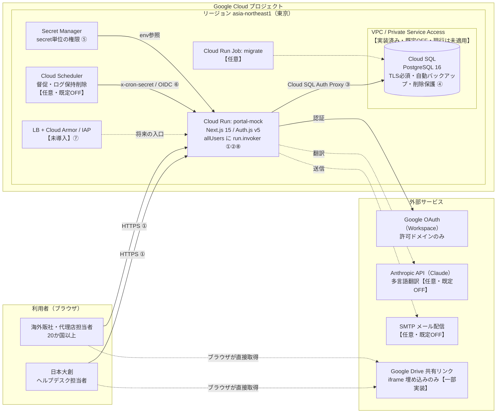

# ヘルプデスクポータル システム構成図（インフラレビュー用）

更新日: 2026-10-30（初版 2026-09-07）
目的: インフラチームによるセキュリティ・構成上の確認のための1枚資料。実装状況（実装済み／任意・既定OFF／未導入）を区別して記載する。

図の画像版は同ディレクトリの `system-architecture.svg` / `.png`。PowerPoint 版（`.pptx`）は 2026-09-07 時点のままで、本更新には含まれていない。

## 前提条件

- ホスティング先は GCP（Cloud Run + Cloud SQL for PostgreSQL）。現行は自社の検証プロジェクト、本番はクライアントの新規プロジェクトを想定
- 環境は dev / prod の2面。インフラは Terraform（`infra/`）で管理
- 利用者は2種類
  - **日本大創（ヘルプデスク担当者）**: 問い合わせ対応、お知らせ・ドキュメント・リンク集・FAQ の管理
  - **海外販社・代理店担当者（20か国以上）**: 問い合わせ・申請の提出、お知らせ・ドキュメント・リンク集・FAQ の閲覧
- 認証は Auth.js v5（JWT セッション）。Google OAuth（許可ドメインのみ）と、メール+パスワード（Credentials）が並存する

## 構成図

読み方: 外側の枠（利用者／GCP プロジェクト／リージョン）→ 入口 → 通信の流れ（矢印）→ 守っている場所（番号）→ 運用（下段）。番号は「守っている場所」の一覧に対応する。

### 運用の仕組み（図の下段）

| 領域 | 内容 | 状態 |
|---|---|---|
| Cloud Logging | 構造化ログ（`auth` 監査、`[api-errors]`）。ログバケット保持は既定 30 日。AuthEvent は DB に 365 日保持。セキュリティ用シンク・Data Access ログは未設定 | 一部実装 |
| Cloud Monitoring | 5xx 率 >5%、p95 >3s、Cloud SQL の CPU / ディスク / 停止、ERROR ログ 1 件で通知（#229）、uptime check。通知先はメール 1 件。認証・IAM 系のアラートは未設定 | 一部実装 |
| バックアップ・予算 | Cloud SQL 自動バックアップ（PITR は無効）。定期エクスポート（GCS）は Terraform 実装済み・既定OFF。Budget アラートはモジュールのみ | 一部実装 |
| Terraform | `infra/`（modules、envs の dev / prod）。state は GCS バケット。apply は担当者のローカルから実施。月次 plan でドリフト確認 | 実装済み |
| デプロイ経路 | GitHub（main）→ Cloud Build → Artifact Registry → Cloud Run。CI は verify / integration / audit。Actions は SHA 固定、dependabot | 実装済み |

### 守っている場所（図の番号に対応）

1. **入口**: HTTPS、CSP などセキュリティヘッダ。Cloud Run は `allUsers` に `run.invoker` を付与した公開構成のため、保護の主体はアプリ認証（②）
2. **アプリ認証**: Google OAuth（許可ドメインのみ）、bcrypt、5 回失敗で 15 分ロック。リクエストごとに `isActive` を DB で再照会し、無効化を即時反映
3. **DB 接続**: Cloud SQL Auth Proxy（Cloud Run 組込み）。アプリ SA はプロジェクトに対して `cloudsql.client` のみ。TLS 必須（`ENCRYPTED_ONLY`）
4. **DB 保護**: 自動バックアップ・削除保護。private IP 化は Terraform 実装済みだが現行は未適用（public IP）
5. **秘密情報**: Secret Manager（secret 単位の `secretAccessor`）。Cloud Run の env には参照のみ。ロガーで資格情報を伏字化
6. **内部 API**: `/api/cron/*` は `x-cron-secret` を定数時間で比較。OIDC は任意。401 はリクエストログにのみ残る
7. **【ギャップ】** LB・Cloud Armor・IAP が無く、IP 制限・レート制限はない。dev「社内ネットワークのみ」の方針は IaC 未実装
8. **監査**: 認証イベントを記録（メールは HMAC ハッシュ化、IP は /24 に丸める）。管理操作（権限変更・CSV 出力）は INFO ログ

検知条件と対応手順は [`docs/infra/security-monitoring.md`](../infra/security-monitoring.md)、運用手順は [`docs/infra/runbook.md`](../infra/runbook.md) を参照。

## 外部連携先の状態一覧

| # | 連携先 | 用途 | 現状 |
|---|---|---|---|
| 1 | Google OAuth（Workspace、許可ドメイン限定） | 利用者認証 | **実装済み。** サーバー側でドメインを検証（`enable_google_login` + `allowed_email_domains`、ドメインが空なら Terraform が停止）。現行は `revamp.co.jp`、本番はクライアントのドメインのみ。メール+パスワード（Credentials）認証も並存し、無効化するトグルは現状ない。ヘルプデスク担当者の Google 自動作成は実装済みだが既定OFF |
| 2 | Anthropic API（Claude） | 問い合わせ自由記述欄の多言語翻訳 | **実装済み・既定OFF。** `enable_translation` で `ANTHROPIC_API_KEY`（Secret）を注入する。初版の「Google Cloud Translation API」は採用していない。現行の API キーは個人発行のものを流用中 |
| 3 | SMTP メール配信 | お知らせの緊急通知・督促メール | **コード実装済み・既定OFF。** `nodemailer` による送信。`enable_smtp` で接続情報を注入する。本番の接続先は未確定で、未設定の間は送信をスキップする |
| 4 | Google Drive / Docs / Sheets / Slides | ヘルプデスクが登録した資料の共有リンクを埋め込み表示 | **限定的に実装済み。** 公開共有リンクの URL を `<iframe>` で表示するだけで、Drive API 連携ではない（ブラウザが Google から直接取得する）。ユーザー単位の出し分けは検討中。外部共有サービス「CmosyPocket」への置き換えも検討中 |

## インフラチームへの確認事項（想定される論点）

- Cloud Run を `allUsers` 公開としたまま本番化してよいか。LB + Cloud Armor / IAP を置くか（現状は IP 制限・レート制限なし）
- dev の「社内ネットワークのみ」をどう実現するか（IAP / Cloud Armor の IP 許可 / VPN）。現状は IaC 未実装
- prod で Credentials ログインを残すか。Google に一本化する場合、Workspace 側の 2SV 強制と退職者停止の運用
- Cloud SQL の private IP 化と Direct VPC egress を本番で有効にするか（Terraform は実装済み・既定OFF）
- SMTP の送信経路（外部メール配信サービス／社内リレー）と、送信元ドメインの SPF/DKIM
- Anthropic API 送信データ（自由記述欄の内容）の越境処理・データ保持ポリシー。API キーの所有者と上限設定
- Google Drive の共有リンクをユーザー単位で出し分ける場合の Drive API 連携、または CmosyPocket への置き換え
- セキュリティログの保持・シンク・Data Access ログ、通知先の多重化（詳細は `security-monitoring.md` §4・§6）
